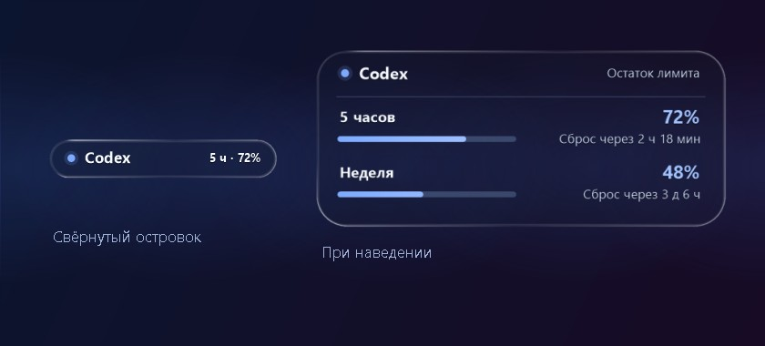
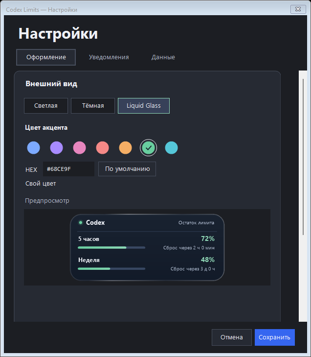

# Codex Limits Widget

Виджет для Windows, который показывает остаток 5-часового и недельного лимитов Codex и время до сброса.

[**Скачать установщик для Windows**](https://github.com/suneevet/codex-limits-widget/releases/latest/download/CodexLimitsWidget-Setup.exe) · [Что нового](https://github.com/suneevet/codex-limits-widget/releases/latest)



## Установка

1. Установите [Codex CLI](https://developers.openai.com/codex/cli/) и войдите в аккаунт ChatGPT.
2. Скачайте и запустите `CodexLimitsWidget-Setup.exe`. Виджет устанавливается для текущего пользователя.
3. Откройте **Codex Limits Widget** из меню «Пуск». Курсор над капсулой раскрывает оба лимита. Щелчок запрашивает обновление, правый щелчок открывает меню.

В свёрнутом состоянии виден остаток 5-часового лимита. Когда он исчерпан, капсула показывает обратный отсчёт до сброса. Виджет скрывается в полноэкранных и распознанных оконных играх. Другие игры можно добавить через меню исключений.

## Оформление

Доступны светлая, тёмная и прозрачная **Liquid Glass**. В настройках можно выбрать готовый акцент или ввести HEX-код. Предпросмотр показывает цвет полос и процентов до сохранения.



## Данные и сборка

Виджет получает лимиты из локального Codex CLI. При временной недоступности запроса может показать последний снимок из локального журнала. Настройки и опциональная история хранятся локально.

Сборка из исходников на Windows x64 через Windows PowerShell:

```powershell
powershell.exe -NoProfile -ExecutionPolicy Bypass -File .\build.ps1 -English
```

Скрипт собирает приложение и запускает проверки. Исполняемый файл появится в `bin/GPTUsageWidget.en.exe`. Для сборки установщика откройте [`installer/CodexLimitsWidget.iss`](installer/CodexLimitsWidget.iss) в Inno Setup 6.7.

Проект основан на [GPT Usage Widget](https://github.com/eespark/gpt-usage-widget) и распространяется по [лицензии MIT](LICENSE).
